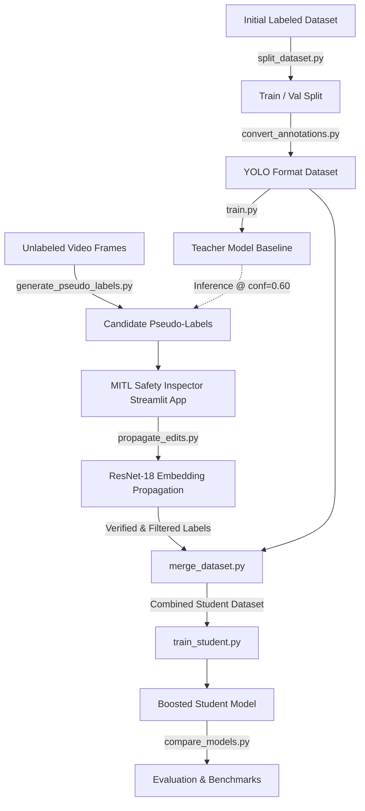

# Semi-Supervised Active Labeling & Model-in-the-Loop (MITL) Safety Inspector

[](https://www.python.org/downloads/)
[](https://docs.ultralytics.com/)
[](https://pytorch.org/)
[](https://streamlit.io/)

A complete end-to-end computer vision pipeline designed to overcome the manual data labeling bottleneck in industrial and construction workplace safety. 

This project implements a **Teacher–Student Semi-Supervised Learning (SSL)** architecture paired with an interactive **Model-in-the-Loop (MITL) Streamlit inspection dashboard**. It features **feature-embedding propagation (via ResNet-18)** that automatically propagates manual bounding box corrections across batches of unseen video frames.

---

## 📌 Problem & Motivation

Manual bounding-box annotation for safety compliance (detecting workers, hardhats, high-visibility vests, heavy machinery, and hazardous zones) is labor-intensive and slow:
1. **Long-tail & small objects**: Hardhats and boots captured by distant surveillance cameras often get missed by manual labelers.
2. **Repetitive errors**: Correcting a recurring false positive across consecutive video frames is tedious and inefficient.
3. **High annotation costs**: Training high-performing vision models typically requires thousands of fully annotated images.

**Solution**: Bootstrap training with a **Teacher model**, generate high-confidence **pseudo-labels** on large unannotated video batches, allow human annotators to review/correct via an interactive **Streamlit MITL Inspector**, propagate those corrections across similar detections using **deep visual embeddings**, and train an augmented **Student model** that demonstrates superior recall and mAP.

---

## 🏗️ Architecture & Pipeline



---

## 🌟 Key Highlights

- **30 Industrial Safety Classes**: Covers personal protective equipment (PPE), personnel (`worker`, `hardhat`, `vest`, `lifevest`, `safetyharness`), and heavy industrial equipment (`crane`, `excavator`, `forklift`, `boomlift`, `roller`, `loader`).
- **One-Click Visual Edit Propagation (`propagate_edits.py`)**:
  - Uses an evaluation-mode **ResNet-18** as a zero-shot feature extractor.
  - When an inspector corrects or deletes a bounding box in the web UI, the system computes the 512-dimensional normalized embedding of the crop.
  - Using **cosine similarity matching** ($\ge 85\%$), the edit is instantly propagated across all matching bounding boxes in the entire batch, saving hours of manual adjustments.
- **Model-in-the-Loop Inspector (`app.py`)**:
  - Built with Streamlit and `streamlit-drawable-canvas`.
  - Enables inspectors to review YOLO detections, adjust bounding coordinates, relabel classes, and trigger one-click batch propagation.
- **Quantitative Benchmark Tracking (`compare_models.py`)**:
  - Automated comparison parser extracting precision, recall, and mAP metrics directly from training run histories.

---

## 📊 Experimental Results

Models were trained and evaluated on industrial CCTV video frames using the Ultralytics YOLO architecture:

| Model | Architecture | Training Set | Precision | Recall | mAP@50 | mAP@50-95 | Key Takeaway |
| :--- | :---: | :--- | :---: | :---: | :---: | :---: | :--- |
| **Teacher (Baseline)** | YOLO11n | Gold-standard annotations only | **0.7334** | 0.3695 | 0.4382 | 0.2676 | Conservative detections, misses small/distant objects |
| **Student (Boosted SSL)** | YOLO11n | Gold + Propagated Pseudo-labels | 0.6715 | **0.3799** (+2.8%) | **0.4424** (+1.0%) | **0.2696** (+0.7%) | Higher recall; successfully captures hard-to-detect hazards |

> **Analysis**: In industrial safety surveillance, **Recall is critical**—a false negative (failing to detect a worker missing a hardhat) poses direct physical danger. The semi-supervised student model increased recall and mAP50 by absorbing high-confidence pseudo-labeled instances without requiring exhaustive manual annotation.

---

## 📈 Evaluation Visualizations

All evaluation curves and confusion matrices are preserved in the [`runs/detect/`](runs/detect/) directory:

- **Student Model PR Curve**: Shows precision-recall trade-offs across all 30 classes (`runs/detect/student_model/BoxPR_curve.png`).
- **Confusion Matrix**: Per-class classification accuracy vs. background false positives (`runs/detect/student_model/confusion_matrix_normalized.png`).
- **Validation Detections**: Ground truth vs. predicted bounding box batches (`runs/detect/student_model/val_batch0_pred.jpg`).

---

## 📂 Project Structure

```
├── app.py                      # Interactive Streamlit MITL Safety Inspector
├── propagate_edits.py          # ResNet-18 visual feature embedding & propagation
├── compare_models.py           # Automated Teacher vs. Student metric evaluation
├── generate_pseudo_labels.py   # High-confidence pseudo-annotation generator
├── merge_dataset.py            # Merges pseudo-annotations with baseline dataset
├── train.py                    # Teacher model baseline training
├── train_student.py            # Distilled student model training
├── split_dataset.py            # Train/validation dataset partitioning
├── convert_annotations.py      # LabelMe JSON -> YOLO txt format converter
├── run_test_with_json.py       # Inference script exporting LabelMe JSON annotations
├── data.yaml                   # 30-class dataset definition
├── requirements.txt            # Python dependencies
├── .gitignore                  # Git exclusions for checkpoints and datasets
└── runs/
    └── detect/
        ├── teacher_model/      # Baseline training logs, PR curves & results.csv
        └── student_model/      # Boosted student logs, PR curves & results.csv
```

---

## 🚀 Getting Started

### 1. Installation
Clone the repository and install dependencies:
```bash
git clone https://github.com/mdwasilraseen/semi-supervised-labelling-model.git
cd semi-supervised-labelling-model
pip install -r requirements.txt
```

### 2. Launching the MITL Safety Inspector
Start the human-in-the-loop dashboard:
```bash
streamlit run app.py
```
From the web interface:
- Load any batch of images with initial predictions.
- Correct, add, or delete bounding boxes using the interactive canvas.
- Click **"Propagate Edit"** to automatically apply your modification to visually identical instances across the entire batch using deep feature matching.

### 3. Comparing Model Performance
To inspect metrics from the completed training runs:
```bash
python compare_models.py
```

---

## 🛠️ Tech Stack
- **Deep Learning**: PyTorch, Torchvision (ResNet-18 feature extraction)
- **Object Detection**: Ultralytics YOLO (v11)
- **Web App / UI**: Streamlit, Streamlit-Drawable-Canvas
- **Data Engineering**: Pandas, NumPy, Pillow, PyYAML, LabelMe JSON Format

